<table><tr>
  <td valign="top"></td>
  <td valign="top"></td>
</tr></table>

<picture>
  <source media="(prefers-color-scheme: dark)" srcset="https://raw.githubusercontent.com/GhostPookie/GhostPookie/output/github-contribution-grid-snake-dark.svg" />
  
</picture>
